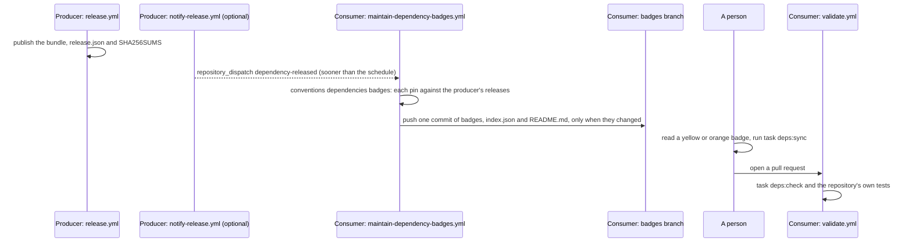

# Keeping dependencies current

A pin is only useful if someone knows when to move it. Without a signal, a consumer falls releases behind until an
upgrade is a project, and a producer cannot retire an old version because nobody knows who still reads it. A pull
request per release was that signal, and it became noise: most were never merged, and the one that mattered was lost
among them. This convention asks each consumer for the same two tasks and a badge per pin instead, so every vendored
copy is verified on each change, and the README says how far behind each pin is without opening anything.

## Scope

This convention covers the tasks, workflows and README badges of a repository that pins another Musher repository's
release: a dependencies declaration ([EC-0032](dependencies-declaration.md)), or the
`github:musher-dev/engineering-conventions` pin in `.config/mise/config.toml`. It checks that they exist and run; the
tasks' implementation is the repository's. Packages, actions and images are kept current by Renovate or Dependabot
([EC-0042](automated-updates.md)), which read their manifests.

## Status and authority

This convention is a **draft** owned by this repository (`authority: self`), and its requirements are `proposed` at
severity `warning`
([decision 0022](https://github.com/musher-dev/engineering-conventions/blob/main/docs/decisions/0022-interfaces-and-dependencies.md),
[decision 0042](https://github.com/musher-dev/engineering-conventions/blob/main/docs/decisions/0042-dependency-currency-is-shown-not-proposed.md)).

## The update flow



The schedule is the guarantee and a notification only makes it sooner, so a producer never has to list its
consumers. `maintain` is the workflow's responsibility: it keeps something of the repository's own current
([EC-0002](../github-actions/workflow-files.md)). Nothing opens a pull request by itself: the person who moves a pin
reads the release first.

| Task | Does |
| --- | --- |
| `deps:check` | Offline: every vendored file against its release record, and code generated from a copy regenerated and compared. |
| `deps:sync` | For each dependency, or one named: fetch the latest release, verify it against its `SHA256SUMS`, replace the copy with the declared interfaces' files and the record, regenerate, and set `version`. |

## Currency badges

`conventions dependencies status` compares each pin with its producer's published releases in the same tag line, and
`conventions dependencies badges --out DIR` renders one badge per pin from that comparison:

| Badge | State | Means |
| --- | --- | --- |
| green, `1.4.2` | `current` | The pin is the newest release of its line |
| yellow, `1.4.2 → 1.6.0` | `behind-minor` | A newer release exists, and it is in the pinned major |
| orange, `1.4.2 → 2.0.0` | `behind-major` | A newer major exists, wherever the pin stands in its own ([decision 0043](https://github.com/musher-dev/engineering-conventions/blob/main/docs/decisions/0043-a-newer-major-always-shows-on-a-currency-badge.md)) |
| grey, `1.4.2` | `unknown` | The producer's releases could not be read, its line has no release, the pin is not `X.Y.Z`, or the pin is newer than every release |

Below 1.0.0 the minor is the breaking part ([decision
0005](https://github.com/musher-dev/engineering-conventions/blob/main/docs/decisions/0005-status-severity-and-versioning.md)),
so there a major is the `0.<minor>` series: `0.9.4 → 0.10.0` is orange. How a badge is judged follows the
`conventions` release the caller's mise configuration pins; these states are 0.9.5's.

A vendored dependency's badge is `<repository>-<output>.svg`; the conventions pin's is `engineering-conventions.svg`.
Both commands read the producers' releases with `gh api`, so the token needs read access to every producer. Neither
fails because a pin is behind.

The reusable workflow
`musher-dev/engineering-conventions/.github/workflows/reusable-maintain-dependency-badges.yml` does the rest: it
installs the conventions release the caller pins, mints a token from a GitHub App that can read the producers, renders
the badges, and force-pushes them as one commit to an orphan `badges` branch, leased on the commit it read
([GHA-46](../github-actions/releases-and-deployments.md#gha-46)), only when they changed. Copy this caller:

```yaml
# .github/workflows/maintain-dependency-badges.yml
name: Maintain Dependency Badges
on:
  schedule:
    - cron: "23 5 * * *"
  repository_dispatch:
    types: [dependency-released]
  push:
    branches: [main]
    paths: [.repo/dependencies.toml, .config/mise/config.toml]
  workflow_dispatch:
permissions: {}
concurrency:
  group: ${{ github.workflow }}-${{ github.ref }}
  cancel-in-progress: false
jobs:
  badges:
    name: Badges
    permissions:
      contents: write  # push the badges branch
    uses: musher-dev/engineering-conventions/.github/workflows/reusable-maintain-dependency-badges.yml@<sha>  # vX.Y.Z
    secrets:
      release-app-private-key: ${{ secrets.RELEASE_APP_PRIVATE_KEY }}
```

The token comes from the release App, installed on every repository. Its client ID is the Actions variable
`RELEASE_APP_CLIENT_ID` and its private key the secret `RELEASE_APP_PRIVATE_KEY`
([GHA-52](../github-actions/releases-and-deployments.md#gha-52)); the App needs only read access to the producers'
contents. A repository that holds the musher-automation App's pair instead passes `automation-app-private-key: ${{
secrets.AUTOMATION_APP_PRIVATE_KEY }}`, read with `AUTOMATION_APP_CLIENT_ID`, with the workflow pinned at 0.9.5 or
later; that App is installed on every repository too. A token that cannot be minted is a warning, not a failure, and
the private producers' pins read grey. Without either secret, the workflow reads the producers with the job's own
token, which sees only public producers, and every other badge is grey. The push trigger turns a badge as soon as a
pin change merges. Then add a badge per pin to the README:

```markdown
[](https://github.com/musher-dev/web/tree/badges)
[](https://github.com/musher-dev/web/tree/badges)
```

`web` is the consuming repository. The `badges` branch also holds `index.json`, the full status, and a `README.md`
that shows every badge in a table. A badge served from a private repository renders only for a viewer with read access
to that repository, which every reader of its README has.

## Requirements

### DEPS-08

**A repository that vendors dependencies defines `deps:check` and `deps:sync`.**

The same two names in every consumer let a person, a hook or a workflow verify and update vendored copies without
reading the repository's Taskfile. A task counts when `task <name>` runs it from the root.

**Correct:**

```yaml
includes:
  deps: taskfiles/deps.Taskfile.yml     # defines check and sync
```

**Incorrect:**

```yaml
tasks:
  api:vendor:check: …                   # a name only this repository uses
```

Checked by: conftest · Severity: warning · Since: 0.7.0

### DEPS-09

**A validate workflow runs `deps:check`.**

A vendored copy edited by hand, or left half-updated, must not merge. DEPS-05 and DEPS-06 see the bytes when the
conventions run; `deps:check` also proves the code generated from them is current, which only the repository's own
tooling can do.

**Correct:**

```yaml
# .github/workflows/validate.yml
      - run: task deps:check
```

**Incorrect:**

```yaml
# .github/workflows/validate.yml
      - run: task test                  # nothing verifies the vendored copies
```

Checked by: conftest · Severity: warning · Since: 0.7.0

### DEPS-10

**A scheduled `maintain-dependencies` workflow runs `deps:sync`.**

Retired in 0.9.4 and replaced by [DEPS-16](#deps-16), with [DEPS-15](#deps-15) beside it. A pull request per upstream
release went unmerged and drowned the updates that mattered; each pin's currency is now a README badge, and a person
runs `deps:sync` when the badge says to ([decision
0042](https://github.com/musher-dev/engineering-conventions/blob/main/docs/decisions/0042-dependency-currency-is-shown-not-proposed.md)).
A `maintain-dependencies.yml` may stay, but nothing asks for it.

Checked by: nothing (retired) · Severity: warning · Since: 0.7.0

### DEPS-15

**The README shows a currency badge for each pin of another Musher release.**

A pin that falls behind is invisible until someone reads the producer's releases. A badge in the README puts the
answer where a reader already looks: the pinned version, and the newer one when there is one. The check reads the root
`README.md` for the path `raw/badges/<repository>-<output>.svg` of each `[[dependencies]]` entry, and for
`raw/badges/engineering-conventions.svg` when `.config/mise/config.toml` pins
`github:musher-dev/engineering-conventions`. Each missing badge is reported on the README.

**Correct:**

```markdown
[](https://github.com/musher-dev/web/tree/badges)
[](https://github.com/musher-dev/web/tree/badges)
```

**Incorrect:**

```markdown
   <!-- the pin, never that it is behind -->
```

Checked by: conftest · Severity: warning · Since: 0.9.4

### DEPS-16

**A `maintain-dependency-badges` workflow refreshes the currency badges on a schedule and on each release.**

A badge is only as current as its last render. The schedule turns a badge even when a producer sends no notification;
a `dependency-released` repository dispatch turns it within minutes when one does. The workflow renders through the
reusable workflow, or runs `conventions dependencies badges` itself. The finding is reported on the declaration, or on
`.config/mise/config.toml` for a repository that pins only the conventions, when the workflow is missing; and on the
workflow when it has no schedule, no `dependency-released` dispatch, or renders nothing.

**Correct:**

```yaml
# .github/workflows/maintain-dependency-badges.yml
on:
  schedule: [{ cron: "23 5 * * *" }]
  repository_dispatch: { types: [dependency-released] }
jobs:
  badges:
    uses: musher-dev/engineering-conventions/.github/workflows/reusable-maintain-dependency-badges.yml@<sha>
```

**Incorrect:**

```yaml
# .github/workflows/maintain-dependencies.yml   # a pull request per release, which nobody merges
on:
  schedule: [{ cron: "17 6 * * 1-5" }]
jobs:
  sync:
    steps:
      - run: task deps:sync
```

Checked by: conftest · Severity: warning · Since: 0.9.4

## References

- [EC-0032 Dependencies declaration](dependencies-declaration.md)
- [EC-0042 Automated dependency updates](automated-updates.md)
- [EC-0002 Workflow files](../github-actions/workflow-files.md)
